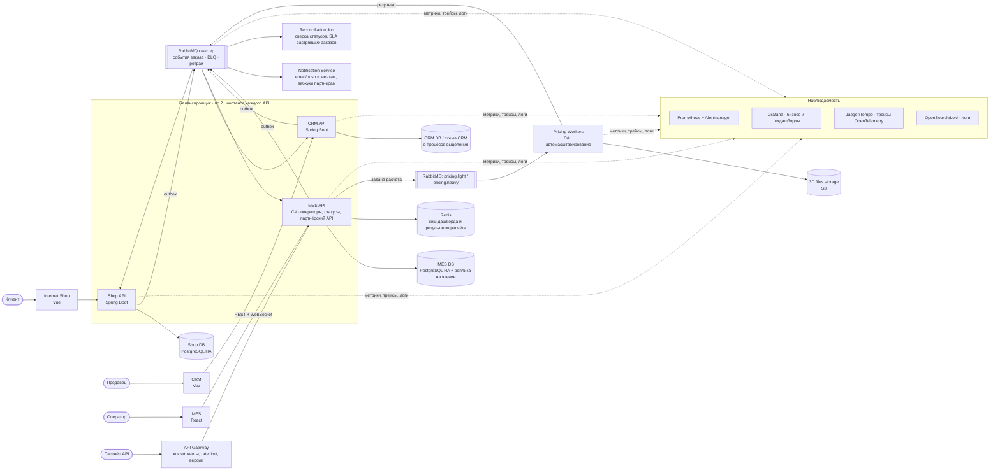

# Планирование: анализ, идентификация проблем и поиск решений

Компания «Александрит» — производство ювелирных украшений, в том числе по 3D-моделям клиентов.

## 1. Исходные данные и как устроен поток заказа

### Компоненты (по схеме C4)

| Контейнер | Технологии | Роль | Хранилище |
|---|---|---|---|
| Internet Shop | Vue, TypeScript, Three.js | Витрина, 3D-конструктор, загрузка модели | — |
| Shop API | Java Spring Boot | Каталог, приём 3D-файла, заказ с точки зрения клиента | Shop DB (PostgreSQL) |
| CRM | Vue, TypeScript | Интерфейс продавцов | — |
| CRM API | Java Spring Boot | Подтверждение заказов (MANUFACTURING_APPROVED), закрытие (CLOSED) | **Пишет в ту же Shop DB** |
| MES | React, TypeScript | Интерфейс операторов: дашборд заказов, взятие в работу | — |
| MES API | C# | Расчёт стоимости, назначение заказов на операторов, список заказов, **публичный API для партнёров** | MES DB (PostgreSQL) |
| Messages Queue | RabbitMQ | Сообщения о новых заказах и смене статусов между CRM и MES | — |
| 3D files storage | S3 | 3D-модели; к нему обращаются Shop API, CRM API и MES API | — |

Инфраструктура:
- Приложения работают в ВМ Yandex Cloud, у каждого приложения **один инстанс**.
- Базы данных — managed PostgreSQL, **один инстанс на чтение и на запись**.
- Окружения: dev, release и prod. В dev деплой автоматический, в release и prod — ручной.

### Путь заказа по статусам

```
 Онлайн-магазин                     MES                    CRM                MES                                   CRM
INITIATED → FILE_UPLOADED → SUBMITTED ──► PRICE_CALCULATED ──► MANUFACTURING_APPROVED ──► MANUFACTURING_STARTED → … → SHIPPED ──► CLOSED
                                    (расчёт 2–3 мин,       (продавец          (оператор сам берёт
                                     до 30 мин)             подтверждает)      заказ с дашборда)
```

Заказ партнёра (B2B) идёт по API: партнёр → MES API (расчёт стоимости) → сообщение в RabbitMQ → CRM создаёт заказ. Онлайн-магазин в этом сценарии не участвует.

Статус одного заказа меняют три системы, и каждая хранит свою копию статуса: Shop DB, MES DB, а CRM пишет в Shop DB. Других каналов синхронизации, кроме асинхронных сообщений RabbitMQ, нет.

### Ключевое наблюдение

Производство справляется с нагрузкой и может выдержать двукратный рост. Значит, заказы опаздывают **до цеха**, а не в нём. Это происходит на одном из трёх участков:
1. Ожидание расчёта стоимости (SUBMITTED → PRICE_CALCULATED).
2. Передача между системами через очередь (MES ↔ CRM, в том числе создание B2B-заказа).
3. Ожидание, пока оператор возьмёт заказ (MANUFACTURING_APPROVED → MANUFACTURING_STARTED).

Сейчас нельзя сказать, на каком из участков застревает конкретный заказ: в системе нет ни метрик, ни сквозных логов, ни трассировки. Поэтому сначала нужно **увидеть** проблему, затем **устранить узкое место** и после этого **исключить потерю заказов**.

---

## 2. Существующие и потенциальные проблемы

Обозначения: **С** — существующая проблема, она уже проявляется в жалобах. **П** — потенциальная: проявится при росте нагрузки или при сбое.

### A. Наблюдаемость

| № | Тип | Проблема | Следствие |
|---|---|---|---|
| A1 | С | Нет мониторинга ни технических метрик (CPU, память, латентность, ошибки, глубина очередей), ни бизнес-метрик: сколько заказов в каждом статусе и сколько времени они там находятся | О просроченных заказах узнают от клиентов, а не от системы. Нельзя определить, на каком этапе застревают заказы |
| A2 | С | Нет алертинга | Падение консьюмера RabbitMQ или зависший расчёт обнаруживают через дни или недели |
| A3 | С | Нет сквозной трассировки и общего идентификатора (correlation id), который прошёл бы через Shop → MES → RabbitMQ → CRM | Нельзя восстановить путь конкретного заказа партнёра, который «не дошёл» |
| A4 | С | Логи разрознены по ВМ, централизованного сбора и поиска нет | Разбор каждой жалобы — ручное расследование на нескольких серверах |
| A5 | С | Нет SLA или SLO по этапам заказа | Продажи обещают три недели, но этот срок ничем не контролируется |

### B. Производительность и масштабируемость

| № | Тип | Проблема | Следствие |
|---|---|---|---|
| B1 | С | Тяжёлый расчёт стоимости (2–3 мин, до 30 мин, зависит от числа полигонов) выполняется в том же **единственном** инстансе MES API, который обслуживает операторов и партнёров | Расчёты конкурируют за CPU и потоки с дашбордом операторов: интерфейс тормозит, растёт очередь на расчёт |
| B2 | С | Нет отдельной очереди задач расчёта с приоритетами. Одна сложная модель на 30 минут занимает ресурс и задерживает десятки простых | Блокировка очереди тяжёлыми задачами (head-of-line blocking), время ожидания непредсказуемо |
| B3 | С | Партнёрский API никак не ограничен: нет квот, rate limiting, приоритизации | После открытия API «компанию завалило заказами»: партнёры могут запрашивать расчёты сотнями, в том числе ради котировок, а не заказов |
| B4 | С | Нет кеша результата расчёта. Одна и та же модель, например повторный запрос партнёра или ретрай после таймаута, рассчитывается заново | Лишняя нагрузка на самый дорогой участок |
| B5 | С | Дашборд операторов строится запросом к основной MES DB, которая одновременно принимает записи. Фильтр и пагинация не помогли: вероятно, нет нужных индексов, считается `COUNT(*)` по большой таблице или используется пагинация через OFFSET | Медленная первая страница MES. Операторы теряют время, а это напрямую задерживает заказы (см. D1) |
| B6 | П | Нагрузка растёт линейно, +100 заказов в месяц, а мощности расчёта и БД фиксированы: по одному инстансу, без автомасштабирования | При текущей архитектуре деградация будет нарастать каждый месяц |
| B7 | П | Каждая БД — один инстанс без реплик на чтение | Отчёты и дашборды мешают транзакционной нагрузке |

### C. Надёжность и целостность данных

| № | Тип | Проблема | Следствие |
|---|---|---|---|
| C1 | С | Все приложения, БД и RabbitMQ работают в одном экземпляре: **единые точки отказа**. Балансировщика нет | Перезапуск или сбой MES API останавливает и расчёты, и работу операторов, и партнёрский API |
| C2 | С | Не гарантирована доставка сообщений: неизвестно, включены ли durable-очереди, persistent-сообщения, publisher confirms и ручные подтверждения (ack); нет очередей недоставленных сообщений (DLQ) и повторной обработки | Сообщение «создать заказ» от MES к CRM может потеряться или уйти в бесконечный ретрай. B2B-заказ тогда **не появляется в CRM**, и продавец его не подтверждает. Это прямое объяснение жалоб партнёров |
| C3 | С | Нет паттерна Transactional Outbox: изменение в БД и публикация в RabbitMQ — две независимые операции | Статус в MES DB изменился, а сообщение не ушло (или наоборот). Копии статуса в системах расходятся |
| C4 | С | Обработчики сообщений, скорее всего, не идемпотентны | Повторная доставка порождает дубли заказов или откаты статусов |
| C5 | С | Нет сверки статусов между системами и механизма поиска заказов, «застрявших» в статусе дольше нормы | Застрявший заказ никто не видит месяцами |
| C6 | П | Партнёрский API, по описанию, синхронный, а расчёт идёт до 30 минут | Таймауты HTTP у партнёров ведут к повторным запросам, а те — к дублям и новой нагрузке (B4) |
| C7 | П | Нет резервирования и проверенного восстановления: план аварийного восстановления (DR), учения по восстановлению из бэкапа | Риск потери данных о заказах |

### D. Бизнес-процесс и продукт

| № | Тип | Проблема | Следствие |
|---|---|---|---|
| D1 | С | Операторы сами выбирают заказы, и вознаграждение получает тот, кто взял заказ. Им важно видеть **новые** заказы. Старые и неудобные заказы уходят вглубь пагинации, и их никто не берёт | Отдельные заказы ждут месяцами, хотя мощности цеха свободны. Вероятно, это одна из главных причин просрочек |
| D2 | С | Подтверждение заказа (MANUFACTURING_APPROVED) — ручная операция продавца в CRM без контроля срока и без уведомлений | Заказ может долго ждать подтверждения. С ростом B2B-потока продавцы не успевают |
| D3 | С | Клиенты и партнёры не видят статус заказа и не получают уведомлений: нет вебхуков и статус-API | Клиенты узнают о проблеме, только обратившись к менеджеру. Растёт нагрузка на продажи и недовольство |
| D4 | П | Продажи обещают срок «три недели» без учёта текущей загрузки расчёта и производства | Обещания систематически нарушаются |

### E. Архитектурная связанность

| № | Тип | Проблема | Следствие |
|---|---|---|---|
| E1 | С | CRM API пишет напрямую в Shop DB, а своей БД у CRM нет | Две команды и два сервиса меняют одну схему. Изменения в магазине ломают CRM. Невозможно масштабировать и выпускать сервисы независимо |
| E2 | С | 3D-хранилище используют три сервиса без единого владельца и единой модели доступа | Неясно, кто отвечает за жизненный цикл файлов и за ссылки на них |
| E3 | С | Публичный API для партнёров опубликован прямо с MES API, без API-шлюза | Внешний трафик идёт в ядро производственной системы. Нет версионирования, квот, отдельного масштабирования |

### F. Процессы разработки и поставки

| № | Тип | Проблема | Следствие |
|---|---|---|---|
| F1 | С | E2E-тесты прогоняет вручную один QA-инженер. Баг уровня high или highest блокирует релиз | Задержки релизов выросли с месяца до ещё больших сроков. Исправления проблем с заказами доходят до продакшена слишком медленно |
| F2 | С | Деплой в release и prod ручной, нет быстрого отката. Канареечных и blue-green-развёртываний нет | Каждый релиз рискованный, поэтому их делают редко и крупными партиями, а это ещё больше повышает риск |
| F3 | С | Компетенции распределены неравномерно: MES (C# и React) — критичная и самая нагруженная система, а на C# один разработчик и тимлид, на React частично один Vue-инженер | Высокий bus factor: по MES (исходный код куплен) можно потерять ключевые знания. Узкое место по скорости изменений |
| F4 | П | Один DevOps-инженер на инфраструктуру, CI/CD и будущую наблюдаемость | Перегрузка и единая точка отказа по эксплуатации |

---

## 3. Инициативы

Каждая инициатива привязана к проблемам, которые она закрывает. Размер — ориентировочная трудоёмкость (S — до 2 недель, M — 1–2 месяца, L — больше 2 месяцев) с учётом текущей команды.

| ID | Инициатива | Что входит | Закрывает | Размер |
|---|---|---|---|---|
| I1 | **Мониторинг и алертинг процесса заказа** | Prometheus и Grafana, экспортёры для ВМ, PostgreSQL и RabbitMQ. Метрики RED для API (запросы, ошибки, длительность). **Бизнес-метрики:** число заказов в каждом статусе, время в статусе, длительность расчёта, длина очереди на расчёт. Алерты: заказ в статусе дольше нормы, рост очереди, отсутствие консьюмеров, ошибки. SLO по этапам | A1, A2, A5, C5 (обнаружение) | M |
| I2 | **Сквозная трассировка заказа** | OpenTelemetry в Shop API и CRM API (Java) и MES API (C#). Передача контекста трассировки через HTTP-заголовки и заголовки сообщений RabbitMQ. Сквозной `order_id` в атрибутах спанов. Jaeger или Tempo как хранилище трейсов | A3, частично C2 и C5 | M |
| I3 | **Централизованное логирование** | Структурированные JSON-логи с `trace_id` и `order_id`. Сбор в ELK/OpenSearch (или Loki). Политика уровней и хранения, маскирование персональных данных | A4 | M |
| I4 | **Асинхронный расчёт стоимости и вынос его в отдельные воркеры** | Расчёт становится задачей в очереди. Отдельный сервис-воркер (pricing worker на базе кода MES, C#) масштабируется горизонтально. Очереди с приоритетами и разделением по сложности модели (число полигонов): лёгкие задачи не ждут тяжёлые. Партнёрский API отвечает `202 Accepted` с идентификатором расчёта, результат приходит через вебхук или опрос | B1, B2, B6, C6 | L |
| I5 | **Кеширование результатов расчёта** | Ключ — хеш файла модели плюс параметры (материал, размер), значение — результат расчёта. Хранение в Redis или в таблице с TTL. Повторные и дублирующие запросы не запускают расчёт заново | B4, C6 | S |
| I6 | **Надёжная интеграция через RabbitMQ** | Quorum- или durable-очереди, persistent-сообщения, publisher confirms, ручной ack. DLQ и повторы с экспоненциальной задержкой. Transactional Outbox в MES и CRM. Идемпотентные консьюмеры (ключ — `order_id` + тип события). Схемы и версии сообщений. Кластер RabbitMQ из трёх узлов | C2, C3, C4 | M |
| I7 | **Сверка статусов и контроль застрявших заказов** | Периодическая задача: сравнивает статусы в Shop DB и MES DB, находит заказы в статусе дольше SLA, повторно отправляет потерянные события и заводит задачу продавцу. Отчёт «заказы под угрозой просрочки» | C5, D2, D4 | S |
| I8 | **Оптимизация и кеширование дашборда операторов** | Индексы под фильтр (статус + дата создания), keyset-пагинация вместо OFFSET, отказ от `COUNT(*)`. Реплика MES DB на чтение. Кеш первой страницы и счётчиков по статусам в Redis, инвалидация по событию смены статуса. Обновление списка через WebSocket или SSE вместо полной перезагрузки | B5, B7 | S–M |
| I9 | **Справедливое распределение заказов операторам** | Вместе с бизнесом изменить правило: очередь заказов по сроку и SLA, а не только по новизне. Подсветка заказов, близких к нарушению срока. Автоназначение или бонус за «старые» заказы. Изменение мотивации — решение бизнеса, архитектор готовит данные и варианты | D1 | S (ИТ) + решение бизнеса |
| I10 | **API-шлюз для партнёров** | Отдельный шлюз перед MES: ключи и квоты на партнёра, rate limiting, версионирование, отдельный контур масштабирования. Статус-API и вебхуки для партнёров | B3, E3, D3 | M |
| I11 | **Уведомления клиентов о статусе** | Сервис уведомлений (email и push) по событиям смены статуса. Страница статуса заказа в магазине | D3 | S–M |
| I12 | **Отказоустойчивость инфраструктуры** | Минимум два инстанса каждого API за балансировщиком. Группы ВМ с автомасштабированием (или переход в Managed Kubernetes). HA-кластеры managed PostgreSQL (мастер и реплика), проверка восстановления из бэкапа | C1, C7, B6, B7 | M |
| I13 | **Автоматизация тестирования и CD** | Автоматические E2E- и API-тесты (QA-инженер уже делал прототипы) в пайплайне. Контрактные тесты сообщений между CRM и MES. Автодеплой в release после зелёных тестов. Деплой в prod одной кнопкой с автоматическим откатом. Feature flags. Переход к частым небольшим релизам | F1, F2 | M–L |
| I14 | **Разделение данных CRM и магазина** | Собственная БД CRM, обмен с магазином через события и API вместо общей схемы (паттерн Strangler: сначала отдельная схема и представления, затем перенос) | E1 | L |
| I15 | **Владелец и единый доступ к 3D-хранилищу** | Сервис файлов: загрузка через presigned URL, метаданные, хеш модели (нужен для I5), политика хранения | E2, B4 | S–M |
| I16 | **Найм и развитие команды** | Второй C#-разработчик для MES (bus factor, I4, I6). SRE или второй DevOps для наблюдаемости, HA и CI/CD (I1–I3, I12). QA-автоматизатор — либо развить текущего QA, либо нанять второго, если ручное тестирование нельзя оставить без исполнителя. Позже — React-разработчик или обучение Vue-инженера | F3, F4 | — |

---

## 4. Приоритизация

### Критерии

1. **Влияние на текущий ущерб.** Компания теряет крупные контракты и клиентов B2C прямо сейчас, поэтому первыми идут инициативы, которые быстро сокращают число просроченных и потерянных заказов.
2. **Невозможно лечить то, чего не видишь.** Без измерений любые оптимизации — догадки. Измерения нужны и для того, чтобы доказать эффект изменений бизнесу.
3. **Устранение первопричин, а не симптомов.** Найм операторов или новые мощности цеха не помогут: узкое место — в ИТ-системе.
4. **Соотношение стоимости и эффекта, риски и возможности команды.** Код MES знают всего два человека, поэтому крупные переделки MES нужно дозировать и прикрывать тестами и мониторингом.
5. **Зависимости.** Например, I5 нужен хеш файла из I15 (минимальный вариант — посчитать хеш в самом MES), а I7 опирается на метрики из I1.

### Ход рассуждений

- **Где теряется время?** По описанию есть три кандидата: расчёт стоимости, очередь между MES и CRM, ожидание оператора. Мощности производства не ограничивают. Рост жалоб совпал с открытием API, а партнёрский поток (1) нагружает расчёт в MES и (2) полностью зависит от доставки сообщения MES → CRM. Обе точки — внутри ИТ-системы. Значит, нужно одновременно (а) включить измерения, чтобы подтвердить гипотезу на данных, и (б) начать устранять самое вероятное узкое место — расчёт.
- **Почему расчёт — главное узкое место.** Это единственный этап, чья длительность растёт с нагрузкой нелинейно. Все расчёты идут в одном инстансе, тяжёлые задачи блокируют лёгкие, повторы партнёров после таймаутов умножают нагрузку. Тот же инстанс обслуживает операторов, поэтому медленный дашборд, скорее всего, частично вызван расчётами, а не только запросом к БД.
- **Почему надёжность доставки сообщений — следующий критичный фактор.** Партнёры жалуются, что «не получили заказы». Это похоже не на медленную обработку, а на потерю: если сообщение о создании заказа не дошло до CRM, заказ не просто опаздывает — его не существует для продавца. Каждый такой случай — потерянный клиент. Сделать доставку гарантированной (outbox, ack, DLQ, идемпотентность) дешевле, чем потом разбирать каждый случай вручную.
- **Дашборд операторов.** Проблема реальная, но частично уйдёт после выноса расчёта (I4). Остальное закрывается локальными доработками I8 (индексы, keyset-пагинация, кеш). Это быстрые победы, которые можно делать параллельно, но они не устраняют потерю заказов.
- **Процессы (I13) и инфраструктура (I12).** Без них каждый следующий релиз будет идти месяц. Но это долгий путь, и эффект для клиентов он даёт не сразу. Минимальная часть — автотесты на критический путь заказа и автодеплой в release — нужна уже для безопасного выпуска I4 и I6.

### Итоговый порядок

| Приоритет | Инициатива | Почему здесь |
|---|---|---|
| 1 | I1 Мониторинг и алертинг процесса заказа | Без него нет ни диагностики, ни контроля эффекта. Быстро запускается силами DevOps. Сразу даёт список застрявших заказов, по которому продажи могут работать уже сейчас |
| 2 | I4 Асинхронный расчёт стоимости в отдельных воркерах | Главное узкое место по пропускной способности, корень медленного дашборда и таймаутов партнёров |
| 3 | I6 Надёжная интеграция через RabbitMQ | Устраняет потерю заказов партнёров, то есть причину потерянных контрактов |
| 4 | I2 Сквозная трассировка | Позволяет разобрать каждый «потерянный» заказ и найти редкие ошибки, которые метрики не покажут |
| 5 | I8 Оптимизация и кеширование дашборда | Быстрые победы для операторов |
| 6 | I7 Сверка статусов и контроль застрявших заказов | Страховка поверх I6: ловит то, что всё же потерялось |
| 7 | I5 Кеш результатов расчёта | Дешёвое снижение нагрузки на расчёт, хорошо дополняет I4 |
| 8 | I9 Справедливое распределение заказов | Высокий эффект, но требует решения бизнеса. Данные для обсуждения даст I1 |
| 9 | I3 Централизованное логирование | Ускоряет разбор инцидентов, логично строится вместе с I2 (`trace_id` в логах) |
| 10 | I13 Автоматизация тестирования и CD | Нужна, чтобы изменения выходили быстро и безопасно. Минимальная часть начинается параллельно с 1–3 |
| 11 | I10 API-шлюз для партнёров | Квоты и статус-API для партнёров. Минимальный rate limiting можно включить раньше на балансировщике |
| 12 | I12 Отказоустойчивость инфраструктуры | Нужна для горизонтального масштабирования воркеров (I4) и устранения единых точек отказа |
| 13 | I11 Уведомления клиентов | Снимает нагрузку с продавцов и снижает недовольство |
| 14 | I16 Найм | Начинать сразу: поиск занимает 1–3 месяца |
| 15 | I15 Сервис 3D-файлов | Минимальная часть (хеш файла) нужна для I5 |
| 16 | I14 Разделение данных CRM и магазина | Важная, но долгая работа по снижению связанности. Не влияет на текущий ущерб |

---

## 5. Целевая архитектура через полгода

### Принципы

- Тяжёлые вычисления отделены от интерактивных интерфейсов.
- Внешний трафик идёт через шлюз, а не напрямую в ядро MES.
- Все межсистемные события доставляются гарантированно и обрабатываются идемпотентно.
- Каждый заказ можно отследить от корзины до закрытия: метрики, трейсы и логи связаны по `order_id` и `trace_id`.
- Нет единых точек отказа на критическом пути заказа.

### Схема (C4, уровень контейнеров, упрощённо)



### Что меняется по сравнению с текущей архитектурой

| Область | Сейчас | Через полгода |
|---|---|---|
| Расчёт стоимости | Синхронно в единственном MES API | Асинхронные задачи в очереди. Отдельные масштабируемые воркеры, разделение лёгких и тяжёлых моделей. Кеш по хешу модели |
| Партнёрский API | Напрямую в MES API, без ограничений | API-шлюз: ключи, квоты, rate limit. `202 Accepted` с идентификатором расчёта, статус-API и вебхуки |
| Интеграция | RabbitMQ без гарантий доставки | Кластер RabbitMQ, outbox, ack, DLQ, идемпотентные консьюмеры, версионированные схемы событий. Сверка статусов |
| Дашборд операторов | Запрос к единственной MES DB | Индексы, keyset-пагинация, реплика на чтение, кеш в Redis, живое обновление. Подсветка заказов, близких к нарушению SLA |
| Наблюдаемость | Отсутствует | Метрики и алерты (включая бизнес-SLO по этапам), сквозные трейсы, централизованные логи, связанные по `trace_id` и `order_id` |
| Инфраструктура | По одному инстансу всего | 2+ инстанса за балансировщиком, автомасштабирование воркеров, HA-кластеры PostgreSQL |
| Поставка | Ручное E2E-тестирование, ручной деплой, релиз раз в месяц и реже | Автотесты критического пути в CI, автодеплой в release, деплой в prod одной кнопкой с откатом, релиз раз в спринт и чаще |
| Данные CRM | Пишет в Shop DB | Выделение схемы CRM начато, доступ только через собственный API или события (полностью — за горизонтом полугода) |
| Команда | 1 DevOps, 1 C#-разработчик | + SRE или DevOps, + C#-разработчик, QA переходит в автоматизацию |

### Ожидаемые результаты (цели для проверки по метрикам I1)

- Время SUBMITTED → PRICE_CALCULATED: для 95% заказов (p95) не больше 10 минут для обычных моделей и не больше 45 минут для сложных. Не зависит от общего числа заказов в очереди.
- Ноль заказов, потерянных между MES и CRM. Каждое необработанное сообщение видно в DLQ и вызывает алерт.
- Первая страница дашборда MES загружается быстрее чем за 1 секунду (p95).
- Каждый заказ, который превысил норму времени в статусе, виден в дашборде и в алерте в течение часа, а не по жалобе клиента.
- Цикл релиза — не дольше двухнедельного спринта.

---

## 6. Если можно выполнить только три инициативы за полгода

### 1. I1. Мониторинг и алертинг процесса заказа (включая бизнес-метрики и SLO)

**Почему.** Сейчас компания не знает, где застревают заказы. О проблемах сообщают клиенты и партнёры, а не система. Мониторинг:
- **сразу приносит пользу:** первая же метрика «время в статусе» даёт список заказов, которые уже опаздывают, и продажи могут проактивно отработать их до потери следующего контракта;
- **подтверждает или опровергает гипотезы** этого документа на данных: расчёт, очередь или оператор. Если данные покажут другое узкое место, ресурсы на второй и третий пункты будут потрачены правильно;
- **показывает эффект** следующих двух инициатив: без него невозможно доказать бизнесу, что стало лучше;
- **дёшево запускается:** готовые экспортёры для PostgreSQL, RabbitMQ и ВМ, несколько метрик в коде. Это силы DevOps-инженера и небольшие доработки в сервисах. Код MES при этом почти не меняется.

В эту инициативу я включаю и минимальные алерты на отсутствие консьюмеров и рост очередей RabbitMQ: так потерю сообщений будет видно до того, как пройдёт третий пункт.

### 2. I4. Асинхронный расчёт стоимости в отдельных масштабируемых воркерах (вместе с кешем результата из I5 как локальной задачей)

**Почему.** Это главная первопричина и по задержкам, и по деградации интерфейса:
- Расчёт — единственный этап, который выполняется машиной и при этом длится минуты и десятки минут. Сейчас он идёт в одном инстансе вместе с интерфейсом операторов и партнёрским API. Вынос в воркеры **развязывает** эти нагрузки: дашборд операторов перестаёт тормозить из-за CPU расчётов, а партнёрский API перестаёт держать соединения по 30 минут.
- Горизонтальное масштабирование воркеров и разделение очередей на лёгкие и тяжёлые модели убирают блокировку тяжёлыми задачами. Пропускная способность растёт **вместе** с ежемесячным ростом нагрузки, а не фиксируется на одном сервере.
- Партнёрский API по схеме `202 Accepted` + статус + вебхук избавляет от повторов после таймаутов. Кеш по хешу модели (небольшая задача) убирает повторные расчёты одной модели.
- Компания специально выбрала MES из-за расчёта на её стороне и владеет исходным кодом. Поэтому вынести модуль расчёта в отдельный процесс на том же C# реально: бизнес-логику переписывать не нужно, меняется способ запуска.

**Риски.** Для команды это самая трудоёмкая инициатива из трёх: на C# один разработчик и тимлид. Поэтому параллельно начинаю найм второго C#-разработчика. Это не инициатива из списка «трёх», а оргмера.

### 3. I6. Надёжная интеграция через RabbitMQ (outbox, подтверждения, DLQ, идемпотентность)

**Почему.** Это прямая причина того, что партнёры и клиенты **не получают** заказы:
- Заказ партнёра появляется в CRM только по сообщению от MES. Потерянное или неразобранное сообщение — это заказ, которого для продавца не существует. Именно это и стоило компании крупных контрактов.
- После перехода расчёта на асинхронную схему (пункт 2) объём сообщений вырастет. Без гарантий доставки и идемпотентности асинхронность увеличит, а не уменьшит число потерь и дублей. Пункты 2 и 3 должны идти вместе.
- Изменения локальны и хорошо известны: настройки очередей, outbox-таблица, проверка ключа идемпотентности в обработчике. Их можно делать по одному типу событий, начиная с «создать заказ» и «цена рассчитана».

### Почему не выбрал другие инициативы

- **Трейсинг (I2) и логи (I3)** — сильные инструменты разбора, но первую и главную видимость даёт мониторинг. Трейсинг важнее, когда уже понятно, какой участок смотреть. Через полгода он станет следующим шагом.
- **Дашборд операторов (I8)** частично улучшится после выноса расчёта. Индексы и keyset-пагинацию стоит сделать как задачу дежурного техдолга, но это не первая по значимости инициатива.
- **Справедливое распределение (I9)** требует решения бизнеса о мотивации операторов. Задача ИТ — дать данные из мониторинга, и это закрывает пункт 1.
- **CI/CD (I13), HA (I12), API-шлюз (I10)** — важная основа, но эффект для клиентов они дают не сразу. Минимальные части, без которых пункты 2 и 3 нельзя выпустить безопасно, делаются внутри этих пунктов: автотесты на новый контракт расчёта и сообщений, второй инстанс воркера, rate limit на балансировщике.
