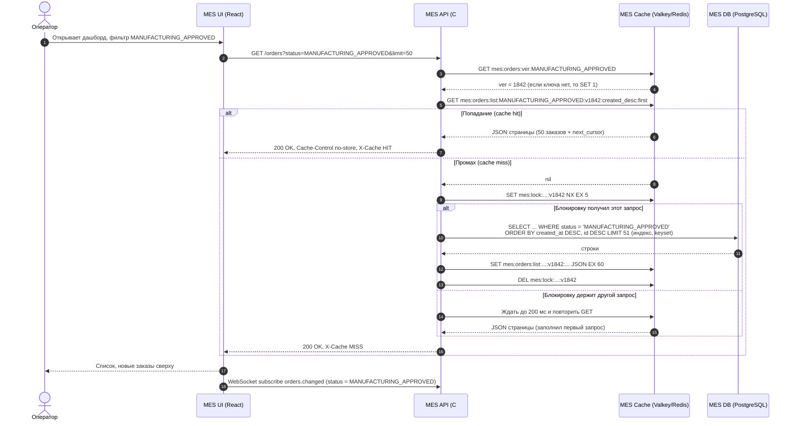
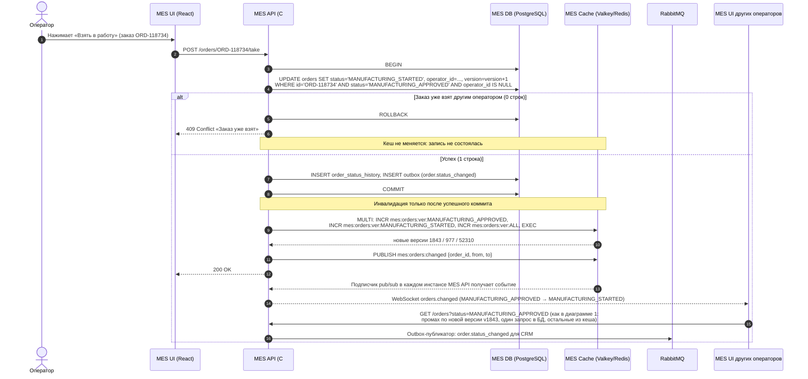
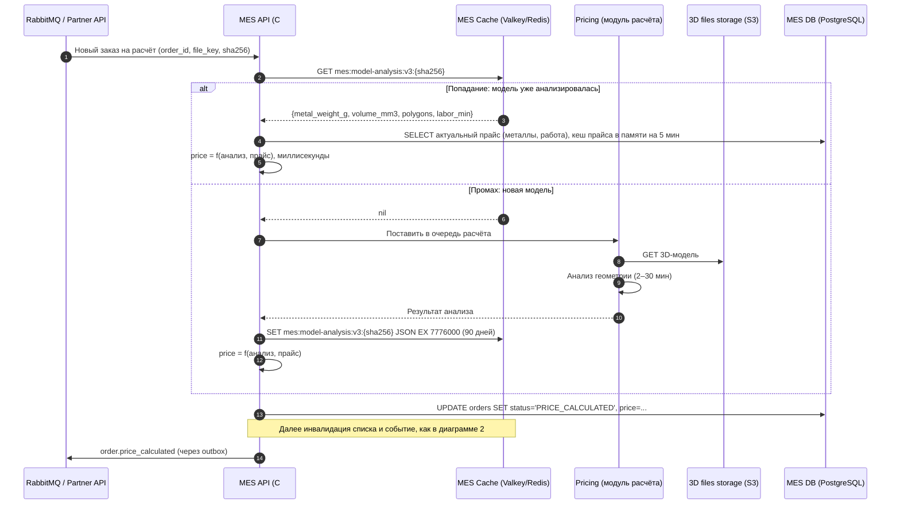
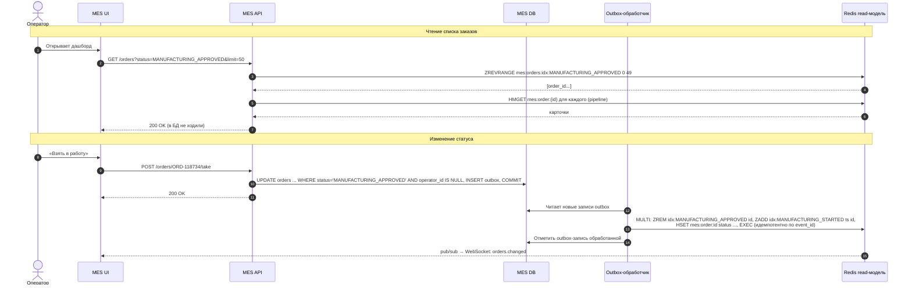

# Архитектурное решение по кешированию

Компания «Александрит», система MES. Документ объясняет бизнесу и разработчикам, что и почему кешируем, и служит справочником при разработке.

**Схема контейнеров** с новыми элементами (красным): [01_caching_containers.drawio](diagrams/01_caching_containers.drawio) ([открыть в браузере](https://viewer.diagrams.net/?nav=1&url=https%3A%2F%2Fraw.githubusercontent.com%2Fhakob-papazian%2Farchitecture-alexandrite%2Fsprint6%2FTask5%2Fdiagrams%2F01_caching_containers.drawio)).

---

## 1. Анализ: что имеет смысл кешировать

### Две жалобы и их причины

| Жалоба | Где возникает | Причина |
|---|---|---|
| **Операторы:** первая страница MES (дашборд заказов по статусам) долго загружается | MES → MES API → MES DB | Каждое открытие и обновление страницы — тяжёлый запрос к **единственному** инстансу MES DB, который одновременно принимает все записи. Фильтр по статусу, сортировка по дате и `COUNT(*)` для пагинации считаются заново на каждый запрос каждого оператора. Операторам важны **самые новые** заказы: кто взял, тот и получил оплату. Поэтому они обновляют страницу постоянно, и нагрузка умножается. Тот же инстанс MES API занят тяжёлыми расчётами стоимости и отвечает медленнее |
| **Новые клиенты** (в первую очередь партнёры API): долго выполняется заказ | MES API: расчёт стоимости (SUBMITTED → PRICE_CALCULATED) | Расчёт идёт 2–3 минуты, до 30 минут для сложных моделей, и выполняется для **каждого** запроса. При этом многие модели повторяются: модели из конструктора собираются из готовых элементов, партнёры повторно запрашивают расчёт той же модели (котировки, повторы после таймаутов). Повторные расчёты занимают ресурсы и удлиняют очередь для всех |

### Кандидаты на кеширование

| Данные | Профиль чтения и записи | Кешируем? | Решение |
|---|---|---|---|
| **Список заказов на дашборде MES** (первые страницы по статусу, сортировка «новые сверху») и **счётчики заказов по статусам** | Читается очень часто: десятки операторов, обновление каждые несколько секунд. Меняется при каждой смене статуса, то есть десятки и сотни раз в час — намного реже, чем читается. Одни и те же данные нужны всем операторам | **Да, главный кандидат** | Серверный кеш (Cache-Aside) + программная инвалидация по событию смены статуса через версии ключей |
| **Результат анализа 3D-модели** (геометрия: объём и вес металла, число полигонов, трудоёмкость) | Вычисляется минуты. Для одного и того же файла результат **не меняется никогда**. Повторные модели встречаются часто | **Да** | Серверный кеш по хешу файла (Cache-Aside) |
| Итоговая цена заказа | Зависит от геометрии **и** от цен на металлы и работы, а они меняются (курс золота — ежедневно) | **Нет как готовое значение** | Кешируем только дорогую геометрическую часть. Цена пересчитывается из неё по актуальному прайсу за миллисекунды |
| Справочники MES (статусы, материалы, типы изделий), статика фронтенда (JS, CSS, текстуры) | Меняются редко, при релизе или изменении справочника | **Да** | Клиентский HTTP-кеш (`Cache-Control`, `ETag`) |
| Карточка конкретного заказа и операции «взять в работу» | Запись, конкурентная между операторами | **Нет** | Всегда работаем с MES DB. Кеш не участвует в записи и не может быть источником истины для назначения заказа |
| 3D-файлы | Уже лежат в S3, читаются при расчёте | Нет | Кеш не нужен: после внедрения кеша анализа модели файл для повторного расчёта не читается |

**Итого:**
- в кеширование включаются **список заказов дашборда MES со счётчиками по статусам** и **результат анализа 3D-моделей**, в MES API;
- справочники и статика MES UI кешируются **на клиенте**.

---

## 2. Мотивация

### Зачем кеширование

1. **Операторы теряют время, а заказы — сроки.** Медленный дашборд — не просто неудобство. Оператор позже видит новый подтверждённый заказ, позже его берёт, а старые заказы теряются в медленной пагинации. Срок «три недели» срывается на этапе MANUFACTURING_APPROVED → MANUFACTURING_STARTED, хотя мощности производства свободны.
2. **Повторные вычисления удлиняют расчёт стоимости для всех клиентов.** Каждый повторный расчёт одной и той же модели — это минуты CPU, которые могли уйти на новые заказы. Партнёры видят долгий ответ и часто повторяют запрос, и нагрузка растёт ещё больше.
3. **Единственные инстансы MES API и MES DB.** Пока нет горизонтального масштабирования (задание 1, I12), каждое снятое с них чтение даёт запас мощности. Кеш дешевле, чем немедленное увеличение БД, и даёт эффект быстрее.
4. **Нагрузка растёт на 100 заказов каждый месяц**, а с B2B-потоком быстрее. Без кеша число запросов дашборда к БД растёт вместе с числом заказов и операторов.

### Какие проблемы должно решить

| Проблема | Как решает кеш | Цель (проверяем метриками из задания 2) |
|---|---|---|
| Медленная первая страница MES | Первая страница и счётчики отдаются из памяти, без запроса к MES DB | p95 загрузки первой страницы < 300 мс (сейчас — секунды) |
| Нагрузка на MES DB от дашборда | Запросы дашборда к БД — только при промахе кеша, то есть после изменения данных | Снижение числа запросов дашборда к MES DB в 10 раз и больше, hit ratio > 90% |
| Операторы не видят новые заказы вовремя | Инвалидация по событию плюс push в MES UI: новый заказ появляется у всех операторов через секунды без ручного обновления | Задержка появления нового заказа на дашборде < 2 с |
| Долгий расчёт повторных моделей | Анализ геометрии повторной модели берётся из кеша, цена считается мгновенно | Время SUBMITTED → PRICE_CALCULATED для повторной модели < 5 с вместо минут. Сокращение очереди расчёта на долю повторов (по метрике `mes_price_calculation_duplicates_total`) |
| Лишний трафик статики и справочников | HTTP-кеш браузера | Повторная загрузка MES UI без скачивания статики |

### Какие элементы системы включаются

- **MES API** — логика Cache-Aside для списка заказов, счётчиков и анализа моделей, инвалидация при смене статуса, публикация события изменения.
- **MES Cache** — новый контейнер: Yandex Managed Service for Valkey (Redis-совместимый). Несколько инстансов MES API (после масштабирования) работают с одним общим кешем.
- **MES DB** — источник истины. Доработки: индексы под фильтр (`status, created_at DESC`) и keyset-пагинация. Без них каждый промах кеша оставался бы медленным.
- **MES UI (React)** — подписка на событие изменения (WebSocket), клиентский HTTP-кеш статики и справочников.
- **Pricing (модуль расчёта в MES API, в перспективе — воркеры из задания 1)** — чтение и запись кеша анализа модели.

---

## 3. Предлагаемое решение

### 3.1. Клиентское или серверное кеширование

| | Клиентское (браузер оператора, HTTP-кеш, состояние React) | **Серверное** (общий кеш в MES API) |
|---|---|---|
| Свежесть данных | У каждого оператора своя копия, она устаревает независимо. Оператор может увидеть заказ, который уже взял коллега | Одна копия для всех. После инвалидации все операторы сразу получают актуальные данные |
| Нагрузка на MES DB | Не снижается: каждый оператор хотя бы раз в период кеша идёт в БД, а «первая загрузка» у каждого своя | Снижается кратно: один запрос к БД обслуживает всех операторов до следующего изменения |
| Инвалидация | Сложная: нужно доставить сигнал в каждый браузер, а после сигнала каждый браузер всё равно идёт в БД | Одна операция в одном месте |
| Справедливость между операторами | Разная задержка у разных операторов прямо влияет на их вознаграждение | Одинаковые данные у всех |
| Кеш анализа 3D-модели | Невозможно: расчёт выполняется на сервере, а клиент партнёра — внешняя система | Подходит |

**Решение:**
- **Серверное кеширование** — для списка заказов, счётчиков по статусам и анализа 3D-моделей. Данные общие для многих пользователей, должны быть одинаково свежими у всех, а цель — снять нагрузку с MES DB и модуля расчёта. Клиентский кеш не решает ни одну из этих задач.
- **Клиентское кеширование** — только для того, что меняется редко и не зависит от других пользователей:
  - статика MES UI: JS и CSS с хешем в имени, `Cache-Control: public, max-age=31536000, immutable`;
  - справочники: `Cache-Control: max-age=3600` + `ETag`, браузер получает `304 Not Modified`.
  
  Для списка заказов в браузере — `Cache-Control: no-store`, чтобы оператор не увидел устаревший список.

### 3.2. Паттерн серверного кеширования

#### Список заказов и счётчики: **Cache-Aside** (ленивое заполнение)

Как работает:
1. MES API получает запрос `GET /orders?status=MANUFACTURING_APPROVED&page=1`.
2. Читает текущую версию данных статуса из кеша и строит ключ.
3. **Попадание** — данные отдаются из кеша.
4. **Промах** — MES API читает данные из MES DB, кладёт в кеш с TTL и отдаёт.
5. При смене статуса MES API пишет **только в MES DB**. После коммита он инвалидирует затронутые ключи (раздел 3.4), а следующий запрос заполнит кеш заново.

| | **Cache-Aside** | Write-Through | Refresh-Ahead |
|---|---|---|---|
| Суть | Приложение читает из кеша, при промахе читает из БД и кладёт в кеш. Запись — в БД, затем инвалидация | Каждая запись синхронно идёт и в БД, и в кеш. Кеш всегда содержит актуальные данные | Кеш заранее обновляет записи до истечения TTL по расписанию или при обращении к записи, близкой к истечению |
| Как подходит для списка заказов | **Лучше подходит**, потому что: 1) в кеш попадают только реально запрашиваемые комбинации (статус + первая страница), а не все возможные; 2) запись остаётся простой транзакцией в БД, кеш на запись не влияет; 3) при недоступности кеша MES продолжает работать с БД — деградация, а не отказ; 4) хорошо сочетается с инвалидацией через версии ключей. Особенности: 1) первый запрос после изменения — промах, его время равно запросу к БД, поэтому БД нужно оптимизировать (индексы, keyset); 2) при массовом промахе (начало смены) нужна защита от одновременных запросов к БД (раздел 3.5) | Позволяет всегда иметь заполненный кеш. **Не позволяет** сделать это дёшево и надёжно: кешируется не сущность, а **агрегат** — страница списка и счётчик. Одна смена статуса меняет минимум две страницы (старый и новый статус), их сортировку и два счётчика. Пересчитывать их синхронно на каждую запись значит, по сути, выполнять тот же тяжёлый запрос на каждую запись. Статусы меняют несколько путей (операторы, консьюмер RabbitMQ, расчёт стоимости), и каждый должен корректно обновить кеш. Ошибка записи в кеш после коммита в БД оставляет кеш неверным, а для двух хранилищ нужна распределённая транзакция. В кеш попадают и данные, которые никто не читает (фильтры и страницы, которые не открывают) | Позволяет отдавать данные без промахов, если запросы предсказуемы. **Не позволяет** гарантировать свежесть: между обновлениями список устаревает. Для операторов, которым важна каждая секунда («кто взял — тот получил оплату»), это неприемлемо. Чтобы устаревание было маленьким, обновлять нужно часто, и тогда нагрузка на БД возвращается даже без изменений. Тратит ресурсы на обновление данных, которые сейчас никто не смотрит (ночью, редкие статусы) |
| Вывод | **Выбран** | Не подходит для агрегатов с частыми записями из нескольких источников | Не подходит как основной. Допустим как дополнение: прогрев первой страницы статуса MANUFACTURING_APPROVED перед началом смены (раздел 3.5) |

#### Анализ 3D-модели: **Cache-Aside** по хешу файла

1. MES API получает заказ на расчёт и вычисляет `sha256` файла модели (или берёт хеш, посчитанный Shop API при загрузке).
2. Ключ: `mes:model-analysis:{algo_version}:{sha256}`.
3. **Попадание** — берём анализ (вес по металлам, объём, трудоёмкость) и считаем цену по текущему прайсу за миллисекунды. Заказ сразу переходит в PRICE_CALCULATED.
4. **Промах** — обычный расчёт в очереди, после него результат анализа кладётся в кеш.

Почему Cache-Aside:
- **Результат по одному хешу неизменен.** Пока не изменился алгоритм, инвалидировать нечего, и Write-Through не даёт никакой пользы.
- **Refresh-Ahead бессмыслен:** обновлять неизменные данные не нужно, а предсказать будущие модели нельзя.
- **Кешируем только то, что действительно встретилось.** Cache-Aside не тратит память на модели, которые больше не придут.

### 3.3. Диаграммы последовательности

Сущности, которые участвуют в кешировании:

| Сущность | Роль |
|---|---|
| **Оператор** | Пользователь дашборда |
| **MES UI** (React) | Запрашивает список, держит WebSocket, перечитывает список по событию |
| **MES API** (C#) | Реализует Cache-Aside: строит ключи, читает и пишет кеш, инвалидирует, публикует события |
| **MES Cache** (Valkey/Redis) | Ключи: `mes:orders:ver:{status}` — версия данных статуса (счётчик). `mes:orders:list:{status}:v{ver}:{sort}:{cursor}` — страница списка (JSON, TTL 60 с). `mes:orders:counts:v{ver_all}` — счётчики по статусам (TTL 60 с). `mes:lock:{key}` — блокировка заполнения (TTL 5 с). `mes:model-analysis:{algo}:{sha256}` — анализ модели (TTL 90 дней). Канал pub/sub `mes:orders:changed` |
| **MES DB** (PostgreSQL) | Источник истины: заказы, статусы, назначения. Таблица outbox для событий в RabbitMQ |
| **RabbitMQ** | Входящие смены статуса от CRM (MANUFACTURING_APPROVED), исходящие статусы MES → CRM |
| **Pricing** (модуль расчёта / воркер) | Анализ 3D-модели, читает файл из S3 |

#### Диаграмма 1. Чтение списка заказов (Cache-Aside)

Счётчики по статусам (`mes:orders:counts:v{ver_all}`) читаются по той же схеме. Версия `ver_all` увеличивается при любой смене статуса.

#### Диаграмма 2. Запись: изменение статуса заказа (оператор берёт заказ в работу)

Те же шаги выполняются при смене статуса **из других источников**: консьюмер RabbitMQ получает MANUFACTURING_APPROVED от CRM, модуль расчёта переводит заказ в PRICE_CALCULATED, оператор отмечает MANUFACTURING_COMPLETED, PACKAGING или SHIPPED. Все пути проходят через один метод `OrderStatusService.ChangeStatus()` в MES API. Инвалидация выполняется там, поэтому её нельзя «забыть» в отдельном обработчике.

#### Диаграмма 3. Расчёт стоимости с кешем анализа модели

### 3.4. Стратегия инвалидации

#### Выбор: **программная инвалидация по событию смены статуса, реализованная через версионирование ключей**, плюс **TTL как страховка**

1. Для каждого статуса в кеше есть счётчик версии `mes:orders:ver:{status}`. Версия входит в ключ каждой страницы списка этого статуса.
2. При смене статуса заказа A → B MES API **после коммита** атомарно (`MULTI/EXEC`) увеличивает версии A, B и `ALL` (для счётчиков).
3. Следующее чтение строит ключ с новой версией и получает промах. Кеш заполняется свежими данными. Старые ключи больше никто не читает, и они удаляются сами по TTL (60 с), поэтому их не нужно искать и удалять.
4. Событие `mes:orders:changed` в pub/sub оповещает MES UI через WebSocket, и операторы видят изменение сразу.
5. **TTL 60 с** — страховочная сетка: даже если инвалидация не сработала (например, сбой сети к кешу сразу после коммита), устаревание ограничено одной минутой. Кроме того, неудачный `INCR` повторяется, а при ошибке пишется WARN-лог и метрика.
6. Защита от гонки «чтение до записи». Читатель сначала берёт версию, потом идёт в БД. Если запись успела закоммититься и увеличить версию, читатель сохранит данные под **старым** ключом, а его уже никто не прочитает. Устаревшие данные под актуальным ключом не попадут.

Для кеша **анализа 3D-моделей** используется **инвалидация по ключу через версию алгоритма**:
- при изменении алгоритма расчёта меняется `algo_version` в ключе (`v3` → `v4`), и старые записи перестают использоваться;
- TTL 90 дней ограничивает объём памяти;
- цена в кеш не попадает, поэтому изменение прайса инвалидации не требует.

#### Сравнение стратегий

| | **Программная по событию + версии ключей** (выбрана) | Временная (только TTL) | По ключу (явное удаление конкретных ключей, DEL) | Остальные стратегии |
|---|---|---|---|---|
| Свежесть | **Лучше подходит**: изменения видны сразу после коммита, без ожидания TTL | Данные устаревают на весь срок TTL. Короткий TTL (2–5 с) почти не снижает нагрузку, длинный (минуты) показывает операторам уже взятые заказы и скрывает новые, а это напрямую влияет на их вознаграждение | Свежесть такая же, как у выбранной, **если** удалить все нужные ключи | Инвалидация по зависимостям (тегам) — тот же результат через множества ключей, но сложнее |
| Сложность реализации | Особенности: 1) все смены статуса должны проходить через один сервисный метод; 2) нужно атомарно увеличивать две-три версии. Ключи страниц перечислять не нужно | Самая простая | Сложно: одна смена статуса затрагивает **неизвестный набор** ключей (страницы, курсоры, сортировки, фильтры). Чтобы удалить их все, нужно либо `SCAN` по шаблону (дорого, блокирует Redis при большом числе ключей), либо вести множества ключей (теги) и поддерживать их согласованность | Очередь инвалидации (CDC из БД через Debezium) — надёжнее, но для MES излишне: нужна инфраструктура Kafka/Debezium, а все записи и так идут через MES API |
| Нагрузка на кеш | `INCR` — O(1). Старые ключи истекают сами | Минимальная | `SCAN` или поддержка множеств ключей | — |
| Поведение при сбое | Без инвалидации — устаревание не больше TTL (60 с) | Устаревание не больше TTL | Пропущенный DEL — данные устаревают до TTL | — |
| Поведение при нескольких инстансах MES API | Версии в общем кеше — согласованно для всех инстансов | Согласованно | Согласованно | Локальный кеш в памяти каждого инстанса потребовал бы рассылки инвалидации всем инстансам |
| Вывод | **Выбрана** | Только как страховка (TTL 60 с) | Не подходит для агрегатов-списков. Используется точечно для единичных ключей (например, `mes:orders:counts`) | Не нужны на текущем масштабе |

### 3.5. Детали реализации

| Тема | Решение |
|---|---|
| **Технология кеша** | **Yandex Managed Service for Valkey** (Redis-совместимый, бывший Managed Service for Redis), конфигурация мастер + реплика в разных зонах. Память 4 ГБ на старте. C#-клиент — **StackExchange.Redis**. Managed-вариант выбран, потому что DevOps-инженер один |
| **Что кешируем в списке** | Только **первые 3 страницы** каждого статуса для сортировки «новые сверху». Это то, что смотрят операторы. Более глубокие страницы и редкие фильтры читаются напрямую из БД через keyset-пагинацию по индексу. Размер страницы — 50 заказов. В кеше только поля для карточки списка (ID, дата, тип изделия, срок, приоритет), без ПДн клиента |
| **Счётчики по статусам** | Вместо `COUNT(*)` на каждый запрос: кешированный результат одного агрегирующего запроса `GROUP BY status`, ключ с версией `ALL` |
| **Защита от одновременного заполнения** (thundering herd) | Блокировка `SET NX EX 5` на ключ заполнения: в БД идёт один запрос, остальные ждут до 200 мс и читают из кеша. Если ожидание превышено, запрос идёт в БД напрямую (без записи в кеш), чтобы не ждать бесконечно |
| **Прогрев (элемент Refresh-Ahead)** | За 5 минут до начала смены фоновая задача заполняет первые страницы статусов MANUFACTURING_APPROVED и MANUFACTURING_STARTED. В течение дня прогрев не нужен: инвалидация по событию и Cache-Aside справляются |
| **Отказ кеша** | Circuit breaker: при ошибках или таймауте кеша (> 50 мс) MES API временно читает напрямую из БД. Это деградация скорости, но не отказ. Алерт DevOps |
| **Согласованность записи** | Источник истины — только MES DB. Взятие заказа делается условным `UPDATE … WHERE status=… AND operator_id IS NULL`: два оператора не возьмут один заказ, даже если у обоих в кеше был старый список. Второй получит 409 и обновлённый список |
| **Живое обновление UI** | WebSocket (SignalR в ASP.NET Core) из MES API. Сообщения рассылаются через Redis backplane между инстансами. Это заменяет постоянное ручное обновление страницы операторами и само снижает нагрузку |
| **Сериализация** | JSON (System.Text.Json), версия схемы в ключе (`list:v2:`), чтобы новый релиз не читал старый формат |
| **Безопасность** | Кеш доступен только из подсети MES API, TLS и пароль (из Lockbox). Ключи и значения без ПДн |
| **Мониторинг** (задание 2) | `mes_cache_requests_total{cache, result=hit/miss}` (hit ratio), `mes_cache_latency_seconds`, `mes_cache_invalidations_total{status}`, `mes_cache_lock_wait_total`, память и вытеснения Valkey (`evicted_keys`). Алерты: hit ratio < 70% за 15 мин, недоступность кеша, рост вытеснений |
| **Оценка памяти** | Списки: ~10 статусов × 3 страницы × ~25 КБ ≈ 1 МБ плюс старые версии до истечения TTL — единицы МБ. Анализ моделей: ~1 КБ × 100 тыс. моделей ≈ 100 МБ. 4 ГБ хватает с большим запасом, политика вытеснения `volatile-lru` |
| **Предварительные доработки БД** | Индекс `(status, created_at DESC, id DESC)`, keyset-пагинация вместо OFFSET. Без них промах кеша остаётся медленным |

### 3.6. План внедрения

| Шаг | Что делаем | Результат |
|---|---|---|
| 1 | Индексы и keyset-пагинация в MES DB, HTTP-кеш статики и справочников | Быстрый промах кеша, снижение лишнего трафика |
| 2 | Managed Valkey, Cache-Aside для первой страницы и счётчиков, версии ключей, `OrderStatusService` с инвалидацией | Основной выигрыш для операторов |
| 3 | WebSocket/SignalR + pub/sub: живое обновление дашборда | Новые заказы видны сразу, операторы перестают постоянно обновлять страницу |
| 4 | Кеш анализа моделей по хешу | Мгновенная цена для повторных моделей |
| 5 | Метрики, алерты, нагрузочный тест в release (сценарий «начало смены») | Подтверждение целей из раздела 2 |

---

## 4. Дополнительное задание: сравнение вариантов решения

Для дашборда операторов рассматривались два архитектурных варианта.

| | **Решение 1: Cache-Aside + инвалидация по событию через версии ключей** (выбрано на ближайшее время) | **Решение 2: CQRS read-модель в Redis, обновляемая при записи** |
|---|---|---|
| **Описание** | Описано выше (разделы 3.2–3.5, диаграммы 1–3). Кеш хранит готовые страницы списка. При смене статуса версии ключей увеличиваются, следующая загрузка страницы читает БД один раз и кладёт результат в кеш | Отдельная **модель для чтения**: для каждого статуса в Redis есть sorted set `mes:orders:idx:{status}` (score — время создания, member — `order_id`) и hash `mes:order:{id}` с полями карточки списка. При смене статуса MES API (или консьюмер событий из outbox) **обновляет read-модель**: `ZREM` из старого статуса, `ZADD` в новый, `HSET` карточки — по сути Write-Through для read-модели. Дашборд читает **только** из Redis: `ZREVRANGE` + `HMGET`, в БД не ходит вообще |
| **Диаграмма** | Диаграммы 1–3 выше | См. ниже |
| **Плюсы** | Простая реализация, укладывается в возможности одного C#-разработчика. Источник истины один (MES DB), рассинхрон невозможен дольше TTL. При отказе кеша система работает через БД. Кеш содержит только то, что реально читают. Подходит для текущей нагрузки с запасом | Чтение никогда не идёт в БД, нет промахов после изменений. Нагрузка на MES DB от дашборда — ноль. Хорошо масштабируется на большое число операторов и заказов. Произвольная пагинация и счётчики (`ZCARD`) без SQL. Естественно ложится на событийную архитектуру (outbox → события → проекции) из задания 1 |
| **Минусы** | После каждого изменения первое чтение — промах, то есть один запрос к БД. При очень частых изменениях (сотни в секунду) hit ratio падает. Поэтому решение рассчитано на текущий масштаб: десятки и сотни изменений в час | Сложнее: нужно поддерживать проекцию при каждом пути изменения статуса, первичную загрузку и восстановление проекции после сбоя Redis (rebuild из БД), а также периодическую сверку проекции с БД. Возможен рассинхрон, если обновление проекции не прошло, поэтому нужен outbox и идемпотентные обработчики. Redis становится критичным: без него дашборд не работает, если не реализован fallback в БД. Нужно больше памяти: в Redis все активные заказы, а не только первые страницы. Больше работы для небольшой команды |
| **Когда выбирать** | Сейчас: быстрый эффект, минимальный риск | Позже, если нагрузка вырастет на порядок или если будут внедрены outbox и событийная интеграция (задание 1, I6) и проекции станут естественным продолжением |

### Диаграмма решения 2 (CQRS read-модель)

### Итог выбора

На ближайшие полгода внедряется **решение 1**. Оно даёт основной эффект — быстрый дашборд, меньше нагрузки на MES DB, живое обновление — при минимальных изменениях в купленной MES и в пределах возможностей команды. **Решение 2** — следующий шаг эволюции, если нагрузка вырастет кратно или если будет внедрена событийная интеграция с outbox. Переход не требует переделки клиента: API `GET /orders` остаётся тем же, меняется только источник данных внутри MES API.
